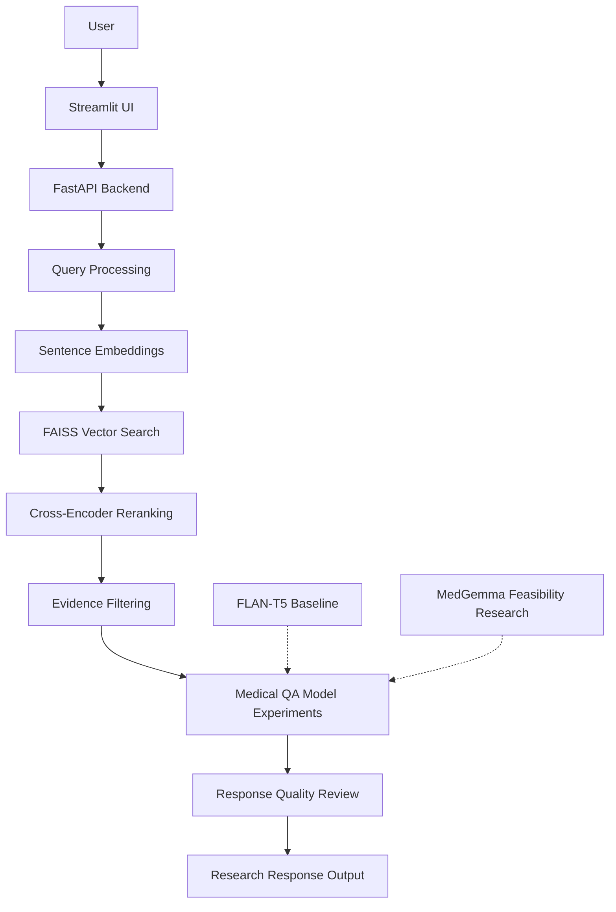
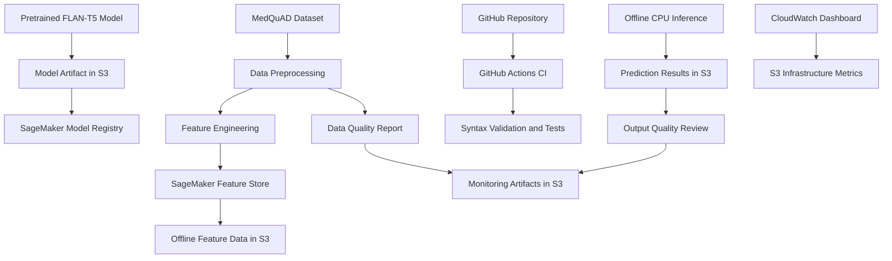
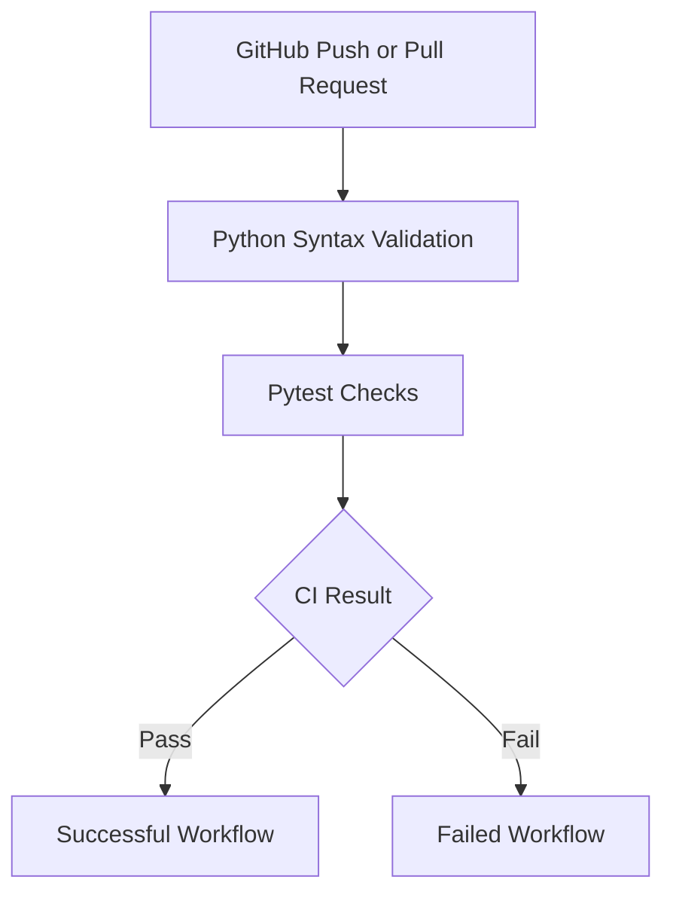

# HealthBrowse AI and MedQuAD Medical Chatbot

**Project status: Active.** HealthBrowse is being prepared for the AAI-590 Capstone course in the Applied Artificial Intelligence Program at the University of San Diego (USD), extending earlier AAI-540 work. The capstone contribution, prior work and uncompleted tasks are separated in the [capstone plan](healthbrowse/docs/capstone/README.md).

**Architecture decision, 17 November 2026:** use **React JS for the frontend and FastAPI for the backend**. This is the selected migration target. The current HealthBrowse deployment still uses JavaScript/Worker routes; this documentation update does not claim that the migration or new model training has been completed.

## Introduction and objective

HealthBrowse helps users ask medical questions, read a cited answer, inspect its sources and ask follow-up questions through Buddy. The General mode uses plain language. The Clinicians mode covers clinical practice and medical education. The objective is to improve relevance and traceability while making limitations visible. The prototype is for education and research; it is not a clinically validated diagnostic product.

The companion MedQuAD Medical Chatbot is the earlier Streamlit/FastAPI medical question-answering research project. Its retrieval and model experiments provide prior work for the capstone. The proposed new study tests whether fine-tuning a medical-passage reranker improves retrieval and the source support of answers. [Current HealthBrowse site](https://healthbrowseai.abhaysrivastava518.chatgpt.site) · [Architecture](healthbrowse/docs/capstone/ARCHITECTURE.md) · [Research protocol](healthbrowse/docs/capstone/EXPERIMENT_PLAN.md)

## How HealthBrowse answers a question

After signing in, a reader chooses **General** or **Clinicians**. That choice controls the language and depth of a medical answer. The subject of the question determines where the browser searches. For example, “What is the main function of the pituitary gland?” follows the medical path for either reader. [Search and audience routing](healthbrowse/dist/app.js)

| Stage | What happens |
| --- | --- |
| Screen the question | The browser checks for urgent symptoms, unsafe requests and identifying details. It can stop the search with guidance or offer choices when a medical question needs clarification. For hosted medical synthesis, the server repeats the safety checks, verifies the session and enforces a request quota before retrieving evidence. |
| Find relevant sources | For medical and biology questions, HealthBrowse searches indexed passages from sources such as MedlinePlus and OpenStax. With live retrieval enabled, it can add biomedical literature from Europe PMC, including eligible open-access full text. For a nonmedical question, a separate route uses curated guides or ranks public results from GOV.UK, Crossref and Wikipedia. |
| Generate and check the medical answer | The configured model drafts from the retrieved passages. On the cited generation path, a second model call checks claim support and the server resolves citations to source records. If generation or review fails, the service can return labeled source excerpts. If it finds too little evidence, it reports the gap. |
| Show the result | General readers get a plain-language explanation. Clinicians get a clinical synthesis, an evidence breakdown and limitations. Readers can inspect citations, open suggested reading and view a credited illustration when a suitable one is available. |

[Query routing](healthbrowse/dist/response-mode.js) · [Medical retrieval](healthbrowse/server/live-evidence.mjs) · [General search](healthbrowse/server/general-browser.mjs) · [Answer API](healthbrowse/server/model-api.mjs) · [Citation review](healthbrowse/server/model-cited.mjs)

**Continue with Buddy.** From the result, the reader can ask a focused follow-up or explore a medical topic in six decks. Buddy receives the active topic and browser summary. Files are attached inside Buddy, where the reader previews extracted content before submitting a question. In document mode, Buddy looks for evidence in the attachment and cites its page, slide or section. Document conversations and questions flagged as personal are excluded from saved chat history. [Buddy](healthbrowse/dist/buddy.js) · [Document retrieval](healthbrowse/server/document-evidence.mjs) · [History rules](healthbrowse/dist/chat-history.js)

**Which model runs?** The example configuration selects the DeepSeek profile. Its defaults are R1-Distill-Llama-8B for General, R1-Distill-Qwen-32B for Clinicians and V3.2 for literature search planning. An operator can check the server's configuration at `GET /api/ai/status`. The independent Llama/QLoRA Model Lab trains and evaluates research adapters in a separate workflow. [Provider configuration](healthbrowse/docs/model-integration.md) · [Medical Model Lab](healthbrowse_model_lab/README.md)

## Installation and development

See [setup.md](setup.md) for the existing application, configuration boundaries and research reproduction. The current browser uses Node 24:

```sh
git clone https://github.com/abby2395/medical_chatbot.git
cd medical_chatbot
cd healthbrowse
npm ci
npm run build
npm test
npm start
```

Open http://localhost:8080. Supabase identity/email delivery and the model provider require separate configuration. Do not place provider secrets in frontend code or Git. React/FastAPI startup commands will be documented and tested when that migration is implemented.

## Contributors

**Principal contributors to the HealthBrowse application end to end: Abhay Srivastav and Chandra Mouli Mudumba.**

The earlier repository credits **Abhay Srivastav, Chandra Mouli Mudumba and Rahul Pawar**. The capstone group has **three members**, confirmed on 17 November 2026; confirm that these earlier names remain the final roster and assign individual responsibilities. No institutional or clinical partner is claimed.

**Submission deadline:** 7 December 2026 at **12:00 AM PST** (America/Los_Angeles), equivalent to **7 December 2026 at 1:30 PM IST**. This means midnight at the start of 7 December in San Diego. For this three-member group, the report limit is 20 pages, the presentation needs at least eight visualizations and each member speaks for at least two minutes. See the [dated delivery schedule](healthbrowse/docs/capstone/PROJECT_PLAN.md).

## Methods and technologies

Current methods include source collection, terminology and keyword retrieval, audience-specific grounded generation, citation checks and automated response regression tests. Prior research includes semantic retrieval, cross-encoder reranking and QLoRA experiments. Proposed capstone methods add leakage-controlled relevance annotation, neural reranker fine-tuning, controlled baselines and independent source-support evaluation.

| Layer | Existing implementation | Selected capstone target |
|---|---|---|
| Browser interface | HTML/CSS/JavaScript | React JS, Vite and React Router |
| Browser API | Worker routes and Node adapter | FastAPI and Pydantic |
| Companion chatbot | Streamlit and FastAPI | Reuse reviewed Python logic behind the shared API |
| Identity and workspace | Supabase Auth; hosted D1 workspace; separate PostgreSQL research components | Supabase Auth plus durable PostgreSQL with ownership enforcement |
| Generation | DeepSeek role-specific synthesis and literature planning, with configurable Groq and custom profiles | Fixed generator baseline while evaluating retrieval changes |
| New training | Not implemented | Compact cross-encoder fine-tuned with PyTorch/Sentence Transformers |
| Delivery | Sites deployment; Node Docker/CI and deployment assets | React/FastAPI container on Cloud Run with tested CI/CD |

The DeepSeek profile selects separate General and Clinician checkpoints. See the [model configuration and verification guide](healthbrowse/docs/model-integration.md) for checkpoint IDs and how to confirm a deployment’s active provider. Llama QLoRA, FLAN-T5 and MedGemma research must not be described as the active production model. A separate model review request does not make responses hallucination-free.

## Data integration and research description

The browser uses a 5 November 2026 MedlinePlus snapshot with 1,017 topics, selected historical clinical passages, targeted CDC/NCI evidence and 4,021 paragraphs from 198 pinned OpenStax anatomy/physiology modules. Live adapters retrieve MedlinePlus summaries and PubMed-indexed Europe PMC abstracts. These are retrieval sources, not evidence that a new model was trained on all of them. The collections overlap and must not be added together as unique training examples.

The [experiment plan](healthbrowse/docs/capstone/EXPERIMENT_PLAN.md) records counts, limitations, a proposed data dictionary, labeling rules, split strategy, baselines and metrics. The new training dataset size and final schema remain to be established. The [collection documentation](healthbrowse/docs/medical-retrieval.md) records licensing and provenance boundaries. Live abstracts are not automatically eligible for redistribution or model training.

**Research question:** Does a trained reranker improve held-out passage relevance and complete, source-supported answers compared with the same candidates and an unchanged pretrained reranker? Evaluate nDCG@10, recall, citation support, answer completeness, safety errors, latency and cost. Hold the generator and corpus constant during comparisons. Independently review source support; do not use the generator's own verdict as ground truth.

**Known roadblocks:** narrow source coverage, query normalization losing distinctions, retrieval errors, provider limits, imperfect support checking and incomplete cloud migration. The previous Llama QLoRA experiment is preserved with its negative findings: [artifact record](healthbrowse/inference/releases/llama3-general-research-002.json) and [grounded-v2 evaluation](healthbrowse/inference/releases/llama3-general-research-002-grounded-v2-evaluation.md). No new accuracy result is claimed.

## Repository map and capstone deliverables

| Location | Responsibility |
|---|---|
| healthbrowse/dist, worker, server | Current browser UI, routing, retrieval, model and account integration |
| healthbrowse/scripts | Source collection/build scripts and response QA |
| healthbrowse/tests | Browser/API regression tests |
| healthbrowse/inference | Historical QLoRA training, serving and reproducible evaluation |
| backend and frontend | Earlier FastAPI and Streamlit companion application |
| src/data and notebooks | Earlier data preparation, EDA and model/retrieval research |
| monitoring, features, models, inference | Earlier model/data monitoring and MLOps artifacts |
| .github and healthbrowse/deploy | Existing CI and deployment assets |
| healthbrowse/docs/capstone | Requirements, architecture, experiment and seven-week plan |

The [submission checklist](healthbrowse/docs/capstone/PROJECT_PLAN.md) maps cleaning, EDA, model design, training, optimization and analysis to the final deliverables. Final submission requires a clean working codebase, a complete file inventory, notebook PDF exports, raw Python code, report, recorded presentation and group peer evaluations. The course requires a neural-network model **and some training**; an application that only calls a hosted model is insufficient by itself.

## License

No root project LICENSE file was present in the audited revision. The maintainers must select a code license; this update does not grant one on their behalf. Source content and model weights retain their own terms, including the pinned [OpenStax license](healthbrowse/docs/licenses/OpenStax-CC-BY-4.0.txt). Review the intended rights before redistribution or commercial use.

## Acknowledgments and resources

We acknowledge the dataset and source maintainers and the University of San Diego course materials used to structure this plan. Their inclusion does not imply endorsement. Add the confirmed instructor and any actual collaborators to the final submission.

- Ben Abacha and Demner-Fushman, *A question-entailment approach to question answering* (2019): https://doi.org/10.1186/s12859-019-3119-4
- MedQuAD source and rights: https://github.com/abachaa/MedQuAD
- MedlinePlus: https://medlineplus.gov/xml.html and https://medlineplus.gov/about/using/usingcontent/
- Europe PMC: https://europepmc.org/RestfulWebService
- OpenStax pinned source: https://github.com/openstax/osbooks-anatomy-physiology/tree/b0058a743bdd2cc08196abaaa7d5469970c0d80c
- Sentence Transformers training: https://sbert.net/docs/cross_encoder/training_overview.html
- React and FastAPI: https://react.dev/learn/build-a-react-app-from-scratch and https://fastapi.tiangolo.com/

## Earlier project record

The historical report below preserves prior attribution and reported experiments. Its older stack, counts and deployment descriptions belong to that earlier work and must not be read as a current end-to-end integration claim. Reproduce historical results before using them in the new capstone analysis.

<details>
<summary>Historical AAI-540 MedQuAD report and experiments — not the current HealthBrowse deployment</summary>

## 1. Project Overview

**MedQuad AI** is a medical question-answering research project designed to investigate the reliability of artificial intelligence in healthcare information retrieval.

The system explores how **Retrieval-Augmented Generation (RAG)**, language models, medical datasets, and AWS machine learning operations can support evidence-grounded medical question answering.

The project focuses on:

- Medical question answering and factuality
- Retrieval relevance and evidence grounding
- Language model experimentation
- Data preprocessing and feature engineering
- Cloud-based machine learning infrastructure
- CI/CD and model governance
- Data quality and model-output monitoring
- Healthcare AI security, privacy, and ethics

**Important:** MedQuad AI is an educational research prototype, not a diagnostic system or clinically validated medical application.

---

## 2. Technology Stack

| Layer | Technology | Purpose |
|---|---|---|
| Frontend | Streamlit | Interactive medical chatbot interface |
| Backend | FastAPI | API endpoints and application logic |
| Programming | Python | Data processing and AI development |
| Dataset | MedQuAD | Medical question-answering research |
| Embeddings | Sentence Transformers | Semantic representations |
| Vector Search | FAISS | Medical passage retrieval |
| Reranking | Cross-Encoder | Improve retrieved evidence relevance |
| Language Model | FLAN-T5 Small | Pretrained baseline and experiments |
| Medical Model Research | MedGemma 4B IT | Medical LLM feasibility investigation |
| Cloud Platform | AWS SageMaker AI | Model governance and research infrastructure |
| Feature Management | SageMaker Feature Store | Feature group and offline feature storage |
| Model Governance | SageMaker Model Registry | Model version registration |
| Storage | Amazon S3 | Models, datasets, and research artifacts |
| Monitoring | Amazon CloudWatch | Infrastructure dashboard |
| CI | GitHub Actions | Automated syntax validation and tests |
| Version Control | GitHub | Source code and experiment documentation |

---

## 3. System Architecture and Workflow

The project separates the user-facing application, retrieval pipeline, model experimentation, and MLOps infrastructure.

### 3.1 Application and AI Workflow



**Implementation note:** The diagram represents the intended application and research architecture. The repository contains Streamlit, FastAPI, retrieval, and model-experiment components, but complete end-to-end deployment and integration have not been independently validated.

### 3.2 AWS MLOps Workflow



The AWS workflow demonstrates feature management, model registration, offline inference, continuous integration, and monitoring configuration. It is not a fully automated production deployment pipeline.

---

## 4. Streamlit Frontend

**Technology:** Streamlit

**Repository:** [`frontend/`](frontend/)

The Streamlit frontend provides the user-interface components for the MedQuad AI application.

### Frontend Components

- Medical chatbot interface
- User interaction and question submission
- Chat display and response presentation
- Authentication-related screens
- Login and signup components
- Interface styling and navigation

The frontend is designed to communicate with the FastAPI backend.

**Status:** Frontend source code implemented in the repository. Production deployment and complete end-to-end integration are not claimed.

---

## 5. FastAPI Backend

**Technology:** FastAPI

**Repository:** [`backend/`](backend/)

The backend provides application and API logic for the MedQuad AI system.

### Backend Responsibilities

- API request handling
- Frontend/backend communication
- Authentication-related application logic
- Session-management components
- Integration points for retrieval and inference services

### Backend Structure

- `backend/main.py`
- `backend/auth/`
- `backend/auth/service.py`
- `backend/auth/session_security.py`

**Status:** Backend implementation files are present. Full API deployment and production security validation remain future work.

---

## 6. Medical Dataset and Data Engineering

### 6.1 MedQuAD Dataset

The project uses the **MedQuAD medical question-answering dataset**, sourced from NIH-related health information resources.

| Processing stage | Records |
|---|---:|
| Cleaned medical question-answer pairs | 16,359 |
| Processed retrieval passages | 38,544 |

### 6.2 Data Processing

The project includes:

- Data ingestion
- Missing-value handling
- Duplicate removal
- Data cleaning
- Medical passage preparation
- Feature engineering
- Exploratory data analysis

**Repository:** [`src/data/`](src/data/)

### 6.3 Data Quality Results

| Metric | Result |
|---|---:|
| Total retrieval passages | 38,544 |
| Duplicate rows | 0 |
| Missing monitored values | 0 |
| Average token length | 149.21 |
| Median token length | 163 |
| Maximum token length | 240 |
| Configured data-quality checks | PASS |

**Evidence:** [Data Quality Report](monitoring/reports/medquad_data_quality_report.json)

These results measure configured data-quality properties, not medical correctness.

---

## 7. Retrieval-Augmented Generation (RAG)

The project investigates retrieval-based evidence selection for medical question answering.

### Retrieval Pipeline

1. Medical question processing
2. Sentence embedding generation
3. FAISS vector similarity search
4. Cross-encoder reranking
5. Evidence filtering
6. Context preparation for language model experiments

### Preliminary Retrieval Evaluation

| Retrieval method | Precision@5 |
|---|---:|
| FAISS retrieval | 30% |
| FAISS with reranking | 42% |

The results are preliminary and based on a limited evaluation sample. They do not represent clinical accuracy or a comprehensive benchmark.

**Research Notebook:** [RAG Retrieval Evaluation](notebooks/rag_retrieval_evaluation.ipynb)

---

## 8. Language Models — FLAN-T5 and MedGemma

### 8.1 FLAN-T5 Small

**Model:** `google/flan-t5-small`

FLAN-T5 Small was investigated as a lightweight text-generation baseline.

The pretrained model was:

- Loaded using CPU resources
- Saved as a model artifact
- Uploaded to Amazon S3
- Registered in SageMaker Model Registry
- Used for a small offline inference demonstration

**Model Registry Group:** `medquad-flan-t5-models`  
**Model Version:** `1`  
**Registration Status:** `Completed`  
**Approval Status:** `PendingManualApproval`

**Important:** The registered checkpoint is a pretrained FLAN-T5 baseline, not a verified MedQuAD-fine-tuned model.

### 8.2 FLAN-T5 Medical Factuality Findings

Five predictions were generated using two unique medical questions.

| Review category | Outputs |
|---|---:|
| Factually incorrect | 3 |
| Circular or uninformative | 2 |
| Total reviewed | 5 |

The model generated medically unreliable responses, including an incorrect description of glaucoma.

These observations demonstrate baseline limitations, not a statistically representative accuracy score.

**Evidence:**
- [Batch Inference Results](inference/outputs/flan_t5_batch_predictions.json)
- [Model Output Quality Report](monitoring/reports/medquad_model_output_quality_report.json)

### 8.3 MedGemma Research

**Model investigated:** `google/medgemma-4b-it`

The MedGemma investigation includes:

- Model repository access verification
- AWS SageMaker hardware assessment
- Medical RAG prompt experiments
- Evidence filtering
- Inference feasibility analysis

AWS Academy permissions and available CPU resources limited the experiments.

**Status:** Research and feasibility investigation. Successful MedGemma deployment or clinically validated inference has not been established.

**Research Notebook:** [MedGemma Inference Research](notebooks/medgemma_inference.ipynb)

---

## 9. AWS SageMaker AI and MLOps

**AWS Region:** `us-east-1`

### 9.1 SageMaker Feature Store

**Feature Group:** `medquad-feature-group`

Features include:

- `record_id`
- `question`
- `source`
- `focus_area`
- `input_token_length`
- `target_token_length`
- `event_time`

**Verified implementation:**
- Feature Group created successfully
- 10 feature records submitted
- 10 offline Parquet files observed in Amazon S3

This is a small-scale Feature Store demonstration, not full-dataset ingestion.

### 9.2 SageMaker Model Registry

**Model Package Group:** `medquad-flan-t5-models`

| Property | Value |
|---|---|
| Model | FLAN-T5 Small pretrained baseline |
| Version | 1 |
| Package status | Completed |
| Approval status | PendingManualApproval |
| Model storage | Amazon S3 |

The registered model artifact is located at:

`s3://medquad-ai-cleaned/models/flan-t5-small-baseline/model.tar.gz`

Registration does not establish successful endpoint deployment or inference-container compatibility.

### 9.3 Amazon S3 Storage

**Bucket:** `medquad-ai-cleaned`

Amazon S3 stores:

- Model artifacts
- Offline Feature Store data
- Batch prediction outputs
- Data-quality reports
- Model-output review reports

### 9.4 Amazon CloudWatch

**Dashboard:** `MedQuad-AI-Infrastructure-Monitoring`

Configured widgets:

- S3 Bucket Storage Size
- S3 Number of Objects

The dashboard was successfully created and viewed. At the time of capture, the S3 metric graphs showed no available data.

No live SageMaker inference endpoint or managed Model Monitor schedule was running.

---

## 10. CI/CD — GitHub Actions

**Workflow:** [MedQuad AI CI](.github/workflows/medquad-ci.yml)

The project implements continuous integration using GitHub Actions.

### CI Workflow



### Verified CI Evidence

| CI demonstration | Result |
|---|---|
| Main branch workflow | Passed |
| Intentional failure demonstration | Failed |
| Python syntax unit test | Passed locally |

The failed workflow was created on a separate demonstration branch and was not intended to be merged into `main`.

**Unit Test:** [Python Syntax Test](tests/test_python_syntax.py)

**GitHub Actions:** [View Workflow Runs](https://github.com/abby2395/medical_chatbot/actions)

**Scope:** The current workflow provides CI validation. Automated AWS deployment, retraining, and infrastructure provisioning are not implemented as continuous delivery.

---

## 11. Model Inference and Monitoring

### 11.1 Offline Batch Inference

Five FLAN-T5 baseline predictions were generated locally using CPU resources and uploaded to S3.

**Evidence:** [FLAN-T5 Predictions](inference/outputs/flan_t5_batch_predictions.json)

This demonstrates offline batch-style inference, not a managed SageMaker Batch Transform job.

### 11.2 Data Quality Monitoring

The data-quality report measures:

- Missing values
- Duplicate records
- Token-length statistics
- Source distribution
- Configured validation checks

**Result:** PASS

### 11.3 Model Output Quality Review

The model-output report documents:

- Observed factual errors
- Circular responses
- Reviewed questions and predictions
- Clinical readiness limitations

**Clinical readiness:** NOT_VALIDATED

These reports are offline monitoring artifacts rather than SageMaker Model Monitor processing-job outputs.

---

## 12. Healthcare AI Security and Ethics

MedQuad AI considers healthcare-specific risks and responsible AI practices.

### Key Considerations

**Patient Privacy**
- Avoid real patient records and identifiable health information
- Use public research data for demonstrations
- Protect sensitive information in any future deployment

**Authorization**
- General-user and healthcare-professional access separation is a design objective
- Production-grade authorization has not been independently audited

**Medical Safety**
- Non-diagnostic system behavior
- Human oversight
- Factuality checks and evidence grounding
- Clear communication of uncertainty
- Avoidance of unsupported medical recommendations

**AWS Security**
- Least-privilege IAM
- Controlled S3 access
- Secrets management
- Encryption and audit logging as deployment requirements

**Healthcare Regulations**

HIPAA and other healthcare policies are design considerations. The project does not claim verified HIPAA compliance.

---

## 13. Project Repository Structure

```text
medical_chatbot/
├── .github/workflows/      # GitHub Actions CI
├── backend/                # FastAPI backend
├── frontend/               # Streamlit interface
├── features/               # Feature engineering
├── models/                 # ML and retrieval scripts
├── src/data/               # Data ingestion and preprocessing
├── deployment/medgemma/    # SageMaker inference job and dependencies
├── notebooks/              # Research notebooks
├── monitoring/reports/     # Data and model quality reports
├── inference/outputs/      # Batch prediction evidence
├── tests/                  # Automated tests
├── requirements.txt        # Dependencies
└── README.md               # Project documentation
```

---

## 14. Installation and Development

### Clone Repository

```bash
git clone https://github.com/abby2395/medical_chatbot.git
cd medical_chatbot
```

### Create Python Environment

```bash
python -m venv .venv
source .venv/bin/activate
```

On Windows:

```bash
.venv\Scripts\activate
```

### Install Dependencies

```bash
pip install -r requirements.txt
```

### Run Unit Tests

```bash
python -m pip install pytest
python -m pytest tests/test_python_syntax.py -q
```

Some experiments require additional datasets, model downloads, AWS permissions, or dependencies. A complete fresh-clone deployment has not been verified.

---

## 15. Research Limitations

The project currently has several limitations:

1. The registered FLAN-T5 model is a pretrained baseline.
2. FLAN-T5 produced medically unreliable answers.
3. MedGemma deployment was not successfully established.
4. Retrieval evaluation used a limited sample.
5. The system has not been clinically validated.
6. No production SageMaker endpoint is running.
7. No managed SageMaker Model Monitor schedule is running.
8. GitHub Actions implements CI, not automated AWS deployment.
9. Feature Store ingestion was demonstrated using 10 records.
10. The CloudWatch dashboard did not yet display populated metric graphs.

---

## 16. Future Research and Development

Future work includes:

- Medical model fine-tuning and comparative evaluation
- Improved RAG grounding and evidence attribution
- Hallucination detection and factuality evaluation
- Confidence-aware abstention
- Clinician-reviewed evaluation datasets
- Secure role-based authorization
- Automated monitoring and drift detection
- Scalable AWS deployment
- Production CI/CD and infrastructure automation
- Healthcare privacy and regulatory assessment

---

## 17. AAI-540 Final Submission Deliverables

### Deliverable 1 — ML System Design Document

The technical report should cover:

- Business and research problem
- Research objectives and impact metrics
- Dataset and data engineering
- Feature engineering
- Model selection and experiments
- Retrieval and model evaluation
- System architecture
- Deployment strategy and constraints
- Monitoring and observability
- CI/CD
- Security, ethics, and limitations
- GitHub repository reference

### Deliverable 2 — Narrated Demonstration Video

Target duration: **9–10 minutes**

Suggested demonstration sequence:

1. Project overview and research problem
2. Streamlit UI and FastAPI architecture
3. Data processing and RAG pipeline
4. FLAN-T5 and MedGemma experiments
5. SageMaker Feature Store
6. SageMaker Model Registry
7. GitHub Actions successful and failed runs
8. Batch inference and monitoring reports
9. CloudWatch dashboard
10. Research limitations and team contributions

Demonstrations should clearly distinguish completed AWS operations from experimental, offline, or proposed functionality.

### Deliverable 3 — Complete GitHub Repository

Repository includes:

- Application source code
- Data processing scripts
- Feature engineering
- Model experimentation code
- Research notebooks
- CI workflow
- Automated tests
- Inference results
- Monitoring reports
- AWS artifact references
- Project documentation

### Deliverable 4 — Individual Peer Evaluation

Each team member completes the individual peer evaluation required by the course.

---

## 18. Academic Credits

**University of San Diego**  
**Shiley-Marcos School of Engineering**  
**MSc in Applied Artificial Intelligence**

**Project Team**
- Abhay Srivastav
- Chandra Mouli Mudumba
- Rahul Pawar

**GitHub Repository:** https://github.com/abby2395/medical_chatbot

---

### Medical Disclaimer

MedQuad AI is intended solely for academic research and educational demonstration. It is not a clinically validated medical device, diagnostic system, or substitute for professional medical advice. Generated responses must not be used to make diagnosis, treatment, prescription, or emergency-care decisions.

### Run the contextual research Copilot locally

Use the existing MedQuad FastAPI/Streamlit and Supabase configuration. Set
`MEDQUAD_PASSAGES_PATH` in the backend environment to the absolute path of
HealthBrowse's `dist/clinical-passages.json`. Set `BACKEND_URL` in Streamlit
(e.g., `http://127.0.0.1:8000` for local development). From the repository root,
start `uvicorn backend.main:app` and `streamlit run frontend/app.py` in separate
terminals. Sign in, choose a topic and numbered deck, and ask an educational question.
The FastAPI routes `GET /copilot/context` and `POST /copilot/answer` accept a
validated existing browser session or a Supabase bearer token. No model or GPU is
needed. The Copilot returns historical excerpts or an explicit abstention. It
does not send research questions to a model service. The index must be supplied
by the operator and is not bundled with this patch. Use
`python -m unittest discover -s tests -p test_copilot.py -v` for fixture checks.
Production authentication, clinical review and privacy controls require separate validation.

## HealthBrowse product workspace

The [HealthBrowse project](healthbrowse/README.md) contains the public research browser, standalone server, personal account API, installable mobile web app, and deployment instructions. Start the standalone service from the `healthbrowse` directory. Repository-level GitHub Actions workflows handle CI, reviewed source updates and optional Cloud Run release.

</details>

