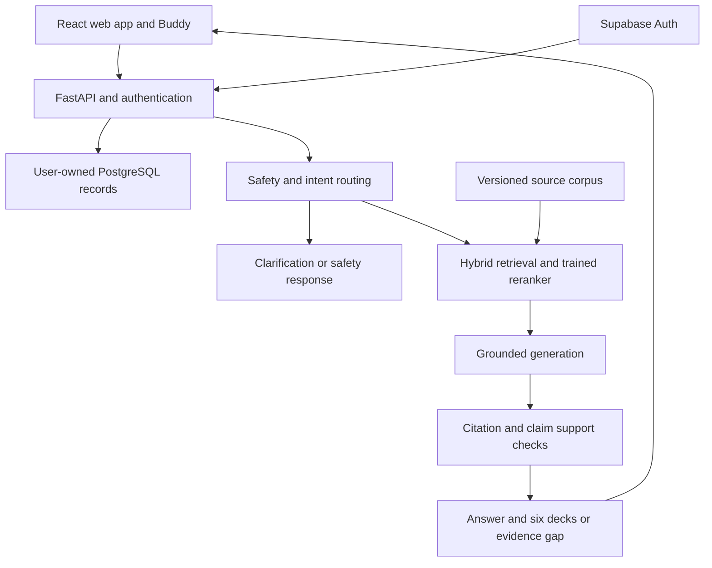

# React and FastAPI architecture

Decision date: 17 November 2026. **Target architecture, not the current deployment.** The existing HealthBrowse web app uses HTML/CSS/JavaScript with Worker routes and a Node standalone adapter. The earlier MedQuAD project has a separate Streamlit/FastAPI application. Those Python components are candidates for reuse after review; their existence does not mean the HealthBrowse browser already runs on FastAPI.

## Components and responsibilities

| Layer | Selected target | Responsibility |
|---|---|---|
| Frontend | React, JavaScript/JSX, Vite, React Router | Authentication screens, search, direct answer, six decks, responsive Buddy and account settings |
| API | FastAPI, Pydantic, Python | Server-side validation, authentication, query routing, retrieval, generation, support checks and workspace endpoints |
| Identity | Existing Supabase Auth | Google OAuth, email/password, email verification and password recovery |
| Durable database | Supabase PostgreSQL, SQLAlchemy, Alembic | User-owned workspaces and research metadata; pgvector for proposed dense passage search |
| Retrieval | Lexical and dense candidates, trained cross-encoder | Preserve query intent and select evidence relevant to the full question |
| Generator | Provider adapter; current baseline Groq openai/gpt-oss-120b | Grounded answer and six structured sections for the selected reading mode |
| Research | PyTorch and Sentence Transformers | Training, validation-only optimization, held-out testing and error analysis |
| Delivery | Docker, GitHub Actions, Google Cloud Run | Tested image, staging release, authenticated smoke tests and rollback |

React's official documentation supports Vite as a build-tool option. FastAPI serves a versioned JSON API with an OpenAPI contract. Supabase remains the identity provider; the backend verifies access-token signatures, issuer, audience and expiry, and derives ownership from the authenticated subject. Browser-supplied user IDs or reading modes never grant authorization.

## Answer and Buddy workflow

1. Validate query length, session and selected reading mode. Classify the actual request before mapping terminology. Preserve numbers, comparisons and negation: “type 1 versus type 2 diabetes” cannot become “type diabetes.” Safety is based on requested behavior; a medical keyword or clinician mode alone is not a reason to block or permit a request.
2. Ask selectable clarification questions only when meaning is materially ambiguous or incomplete. Do not reject a clear anatomy question because it is absent from a disease catalog. A provider outage is an availability error, not a request to rephrase.
3. Retrieve from versioned, licensed sources using the full medical intent. Combine lexical and dense candidates, rerank query–passage pairs, diversify sources and preserve passage identifiers. Treat retrieved text as evidence, never as instructions.
4. Generate a direct answer first. General mode uses plain language and three or four short paragraphs when useful and supported; Medical education emphasizes mechanisms and learning; Clinicians uses precise terminology and evidence limits. The same underlying model can serve these reading modes; different prompts are not different trained models.
5. Return six stable section IDs with topic-appropriate titles. Disease queries cover epidemiology, causes/mechanisms, presentation, diagnosis, management and prognosis. Normal-anatomy queries cover structure, function, regulation, clinical associations, assessment and implications. Mark unsupported sections as gaps; do not invent treatments for normal physiology or pad an answer to reach a paragraph count.
6. Validate schema, citation IDs and URLs against retrieved evidence, then check claim support. Permit one bounded correction attempt; otherwise withhold unsupported portions and explain the gap. A same-model review request is not independent clinical validation.
7. Buddy consumes the active query, answer, evidence and relevant conversation context. It shares the API pipeline, can retrieve evidence for a new medical topic, and stays closed until the user opens it. Notifications come from authenticated application events, not model-generated function tags.

On mobile, Buddy becomes a full-height sheet with a compact header, independently scrolling conversation and pinned composer respecting the keyboard and safe area. On desktop, use a side panel. Keep history and secondary tools behind clearly labeled controls. Search submits on Enter or click, gives immediate progress feedback and offers retry/cancel for failures. Test 320–430 px mobile widths, keyboard-only use and both themes.

## Proposed API contract

These routes are specifications, not implemented endpoints:

| Endpoint | Purpose |
|---|---|
| POST /api/v1/search | Query, reading mode and clarification selection; returns answer, six sections, citations and status |
| POST /api/v1/buddy/messages | Follow-up with authorized conversation and active evidence context |
| GET/PATCH /api/v1/me | Read and edit supported profile preferences; email changes use the identity-provider verification flow |
| GET/POST/DELETE /api/v1/chats | User-scoped history and deletion; individual chat routes also support rename |
| GET/POST/DELETE /api/v1/bookmarks | User-owned saved references |
| POST /api/v1/feedback | Feedback and correction request without automatic truth judgments from sentiment |
| GET /healthz and /readyz | Liveness and bounded readiness checks without exposing secrets |

Answer status distinguishes answered, clarification_required, evidence_insufficient, safety_response and provider_unavailable. Source records include publisher, URL, passage ID, dates, corpus version and evidence type. Return only approved public fields. Store metrics such as request ID, latency, model version and error class; exclude raw medical queries, tokens and personal records from logs.

## Data flow and persistence

Collectors fetch only approved source endpoints; retain source rights, retrieval date, content hash and parser version. Cleaning removes markup and duplicates while preserving medical qualifiers. A reviewed immutable corpus release feeds both offline experiments and the production index. Scheduled refreshes produce a candidate corpus version; evaluate and approve it before publication. The test benchmark stays frozen.

PostgreSQL owns profiles, conversations, messages, bookmarks, preferences and source manifests. Enforce per-user ownership and database row-level protections; privileged service access must not bypass checks in application code. Separate consented saved research conversations from temporary personal questions. Account deletion, history deletion and exports must be tested across two isolated accounts. Training uses reviewed public data, not visitors' conversations.

## Migration sequence

1. Freeze the existing application and capture representative API fixtures and failure cases. Preserve source attribution and existing account records.
2. Implement FastAPI contracts and one complete React search-to-answer flow, then Buddy. Validate direct questions, comparisons, normal anatomy, ambiguity, provider failure and citations before moving accounts.
3. Port authentication/workspace behavior; design a reviewed D1-to-PostgreSQL export/import with ownership, count and rollback checks. Do not migrate user data as part of an unaudited UI change.
4. Add hybrid retrieval and the selected trained reranker only after offline comparison. The baseline generator remains fixed during the ranking experiment.
5. Deploy staging, run mobile/auth/load/ownership tests, then switch production traffic after acceptance. Archive the old interface only after the replacement works.

Proposed new locations are healthbrowse/apps/web, healthbrowse/services/api and healthbrowse/research/reranker. They are not created as empty production scaffolds in this documentation update. Preserve the existing top-level backend and frontend as prior work until the migration decision is complete.

## Google Cloud deployment

For the capstone pilot, build the React static bundle and serve it alongside FastAPI in one container on Cloud Run. Same-origin delivery simplifies cookies, API configuration and CORS. Use managed PostgreSQL outside the container, Secret Manager for provider secrets and Artifact Registry for immutable images. Training runs separately on an appropriately sized GPU; never train during an HTTP request.

GitHub Actions should run frontend checks, Python tests, retrieval fixtures, two-account authorization tests and a container smoke test, then publish a scanned image. Deploy by digest using Workload Identity Federation to staging, verify actual HTTPS login callbacks, recovery and model calls, and retain the last passing revision. Set timeouts consistently, cap instances and monitor spend. A free allowance is not a promise of zero cost. Kubernetes is optional future infrastructure, not necessary for this pilot.

Current Node deployment assets cannot be relabeled as the FastAPI release. The audit also found an external-origin issue in the Node adapter, local SQLite persistence unsuitable for multiple Cloud Run instances, and a deployment timeout shorter than the model pipeline budget. Resolve or replace these paths before claiming Cloud Run readiness.

## References

- React: https://react.dev/learn/build-a-react-app-from-scratch
- FastAPI security concepts: https://fastapi.tiangolo.com/tutorial/security/oauth2-jwt/ (use Supabase token verification rather than building a second password database)
- Cloud Run FastAPI deployment: https://docs.cloud.google.com/run/docs/quickstarts/build-and-deploy/deploy-python-fastapi-service
- Cross-encoder training: https://sbert.net/docs/cross_encoder/training_overview.html
- Existing collection boundaries: [medical retrieval](../medical-retrieval.md)
